# 批量缠论分析报告（chan.py 引擎 · 含买卖点+背驰判断）
> 数据区间：2024-01-01 ~ 2026-11-06

## 京东方A（000725）
- 最新收盘价：4.630000114440918
- 有效K线数量：686
- 笔总数：41 | 中枢总数：6
- 最新一笔走势：下跌 | 2026-09-23~2026-11-02 | 6.31 → 4.26
- 缠论背驰判断：**无背驰**
- 三类买卖点识别：**买1类@2024-09-18(3.63)、买2,3b类@2024-10-16(4.13)、买2s类@2024-11-27(4.30)、买2s类@2025-01-06(4.18)、买1类@2026-11-02(4.34)**
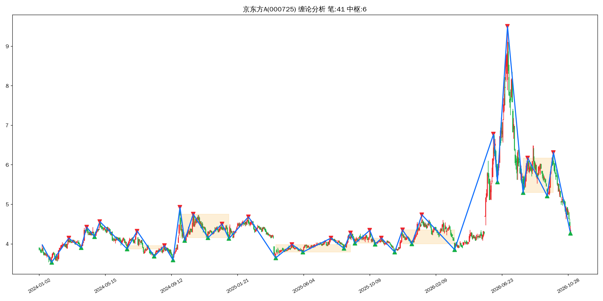

## 格力电器（000651）
- 最新收盘价：38.959999084472656
- 有效K线数量：686
- 笔总数：39 | 中枢总数：6
- 最新一笔走势：上涨 | 2026-10-27~2026-11-04 | 36.01 → 39.54
- 缠论背驰判断：**无背驰**
- 三类买卖点识别：**买1类@2024-07-05(37.70)、买2类@2024-08-13(40.23)、买2s类@2024-09-12(38.66)、卖1类@2025-07-23(48.15)、卖2类@2025-08-12(47.88)、卖3b类@2025-11-12(41.15)、买1类@2026-03-04(36.89)、买2类@2026-04-22(36.94)**
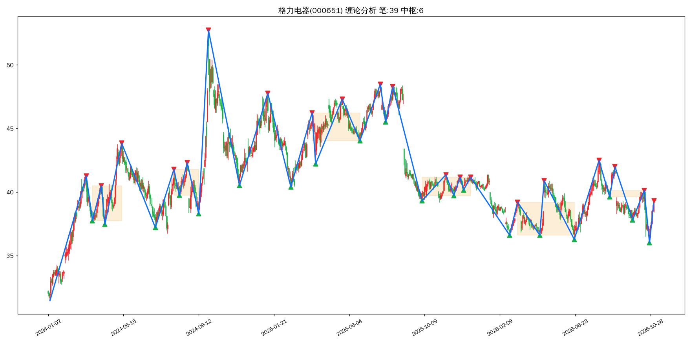

## 长安汽车（000625）
- 最新收盘价：7.190000057220459
- 有效K线数量：686
- 笔总数：37 | 中枢总数：4
- 最新一笔走势：下跌 | 2026-10-27~2026-11-02 | 7.24 → 6.68
- 缠论背驰判断：**无背驰**
- 三类买卖点识别：**买1类@2024-08-29(11.75)、买2类@2024-09-18(11.64)**
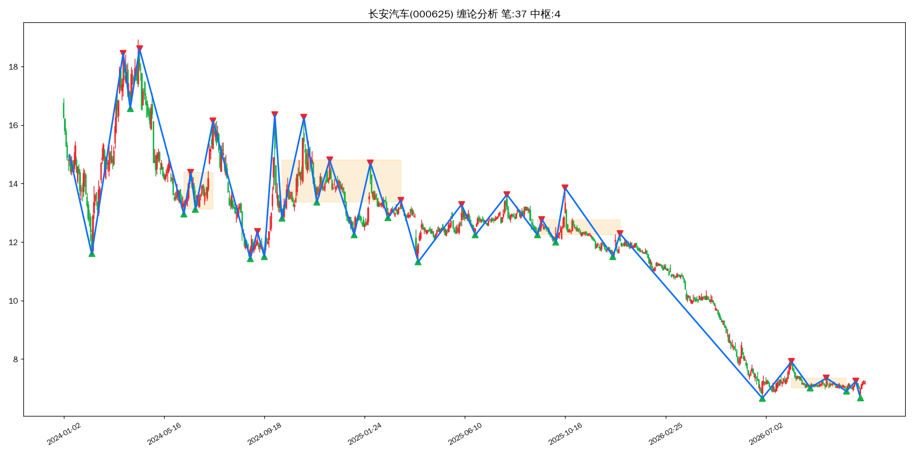

## 海南橡胶（601118）
- 最新收盘价：5.260000228881836
- 有效K线数量：686
- 笔总数：35 | 中枢总数：4
- 最新一笔走势：下跌 | 2026-10-12~2026-10-30 | 7.88 → 4.96
- 缠论背驰判断：**无背驰**
- 三类买卖点识别：**买1p类@2026-07-20(4.68)、买2类@2026-08-14(5.28)**
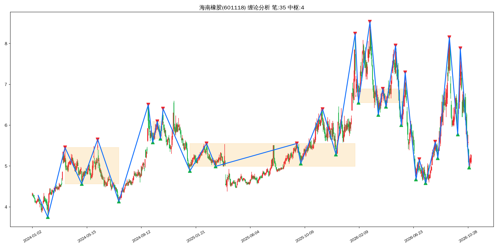

## 科大讯飞（002230）
- 最新收盘价：38.2400016784668
- 有效K线数量：686
- 笔总数：40 | 中枢总数：4
- 最新一笔走势：上涨 | 2026-10-16~2026-10-27 | 35.48 → 39.12
- 缠论背驰判断：**上涨趋势背驰（警惕阶段顶部）**
- 三类买卖点识别：**买1类@2024-08-28(33.32)、买2类@2024-10-16(43.00)、买2s类@2025-01-08(45.09)、卖1类@2025-02-24(57.45)、卖2类@2025-05-08(48.26)、卖2s类@2025-06-09(48.82)、卖2s类@2025-07-01(47.83)、买1类@2026-10-16(36.00)**
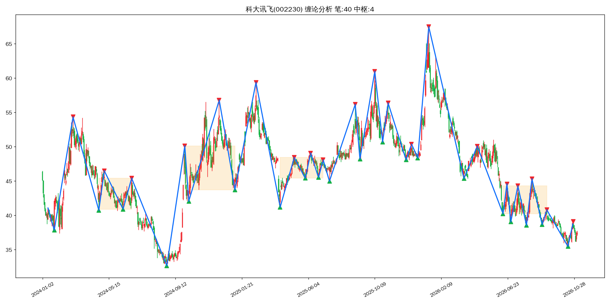

## 中国宝安（000009）
- 最新收盘价：6.670000076293945
- 有效K线数量：686
- 笔总数：29 | 中枢总数：2
- 最新一笔走势：下跌 | 2026-09-22~2026-10-23 | 7.13 → 6.27
- 缠论背驰判断：**无背驰**
- 三类买卖点识别：**买1类@2025-04-09(7.61)、买2类@2025-06-03(7.93)**
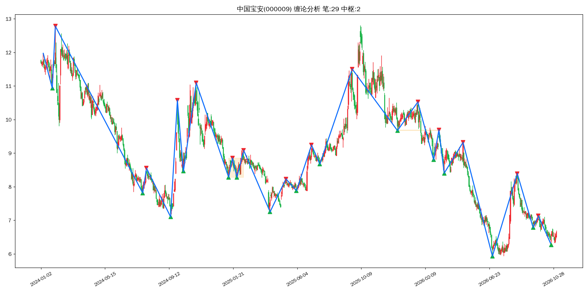

## 海格通信（002465）
- 最新收盘价：10.039999961853027
- 有效K线数量：686
- 笔总数：36 | 中枢总数：3
- 最新一笔走势：上涨 | 2026-10-15~2026-10-26 | 9.01 → 10.14
- 缠论背驰判断：**上涨趋势背驰（警惕阶段顶部）**
- 三类买卖点识别：**卖1类@2025-08-29(14.62)、卖2类@2025-09-12(13.90)、买1类@2026-10-15(9.03)**
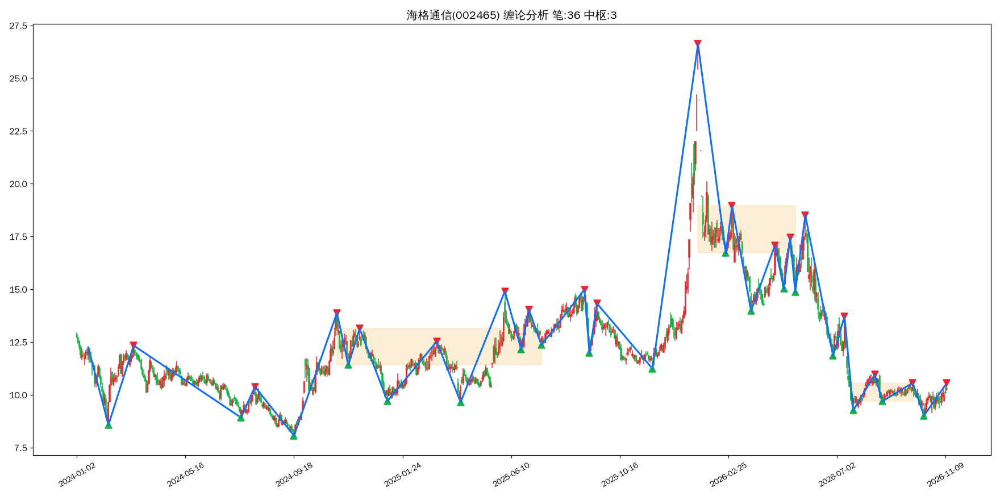

## 郑州银行（002936）
- 最新收盘价：1.8200000524520874
- 有效K线数量：686
- 笔总数：27 | 中枢总数：3
- 最新一笔走势：上涨 | 2026-10-23~2026-11-04 | 1.67 → 1.83
- 缠论背驰判断：**无背驰**
- 三类买卖点识别：**卖1类@2024-12-10(2.26)、卖2类@2025-02-18(2.01)、卖2s类@2025-07-11(2.22)、卖2s类@2025-09-18(2.07)、卖2s类@2025-11-14(2.07)、卖2s,3b类@2026-01-13(1.96)、卖2s类@2026-03-17(1.95)、买1类@2026-07-01(1.68)、买2类@2026-08-24(1.77)、买2s类@2026-10-23(1.70)**
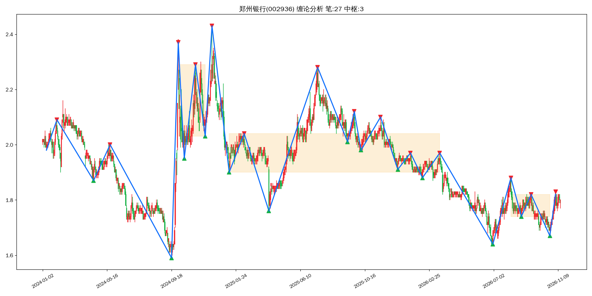

## 中国平安（601318）
- 最新收盘价：54.0099983215332
- 有效K线数量：686
- 笔总数：45 | 中枢总数：3
- 最新一笔走势：上涨 | 2026-10-23~2026-11-04 | 50.11 → 54.79
- 缠论背驰判断：**上涨趋势背驰（警惕阶段顶部）**
- 三类买卖点识别：**买1类@2025-01-13(48.59)、买2类@2025-03-04(50.08)、买3a类@2025-06-19(53.20)、卖1p类@2025-07-30(60.71)、卖2类@2025-08-29(59.88)**
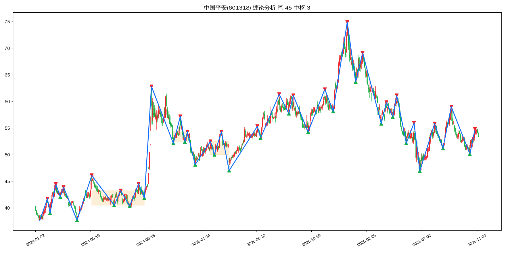

## 美的集团（000333）
- 最新收盘价：87.9800033569336
- 有效K线数量：686
- 笔总数：33 | 中枢总数：5
- 最新一笔走势：上涨 | 2026-10-08~2026-11-04 | 78.30 → 89.69
- 缠论背驰判断：**无背驰**
- 三类买卖点识别：**买1类@2025-04-07(67.18)、买2类@2025-06-16(71.26)、买2s类@2025-07-31(70.19)、买2s类@2025-10-13(71.81)、卖1类@2025-12-04(81.89)、卖2类@2026-02-05(80.45)**
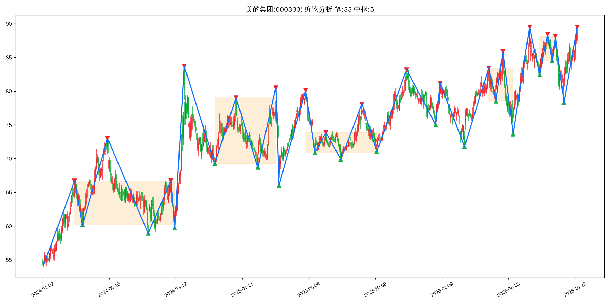

## 比亚迪（002594）
- 最新收盘价：85.1500015258789
- 有效K线数量：686
- 笔总数：52 | 中枢总数：8
- 最新一笔走势：上涨 | 2026-10-23~2026-11-04 | 78.49 → 85.95
- 缠论背驰判断：**无背驰**
- 三类买卖点识别：**卖1类@2025-05-23(135.00)、卖2类@2025-07-24(114.24)、卖2s类@2025-08-29(114.06)、卖3a类@2025-11-14(98.37)、买1p类@2025-11-21(92.70)、买2类@2025-12-18(93.53)**
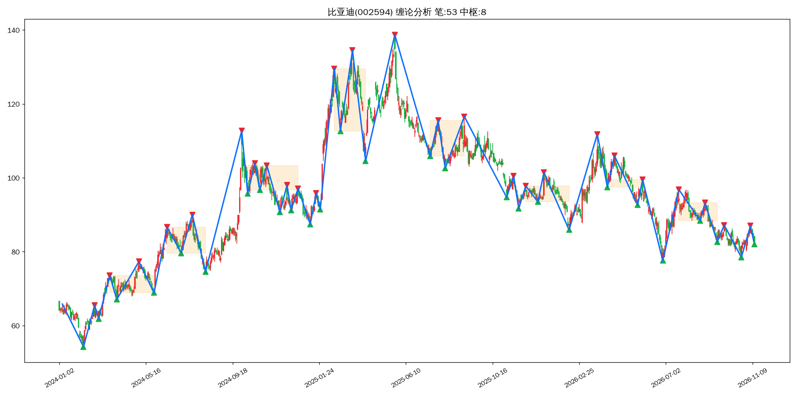

## 上证指数（000001）
- 最新收盘价：3686.173095703125
- 有效K线数量：686
- 笔总数：33 | 中枢总数：3
- 最新一笔走势：下跌 | 2026-09-22~2026-10-23 | 3967.68 → 3574.27
- 缠论背驰判断：**无背驰**
- 三类买卖点识别：**卖1p类@2025-11-14(3990.49)、卖2类@2025-12-08(3924.08)、买1类@2026-10-23(3690.48)**
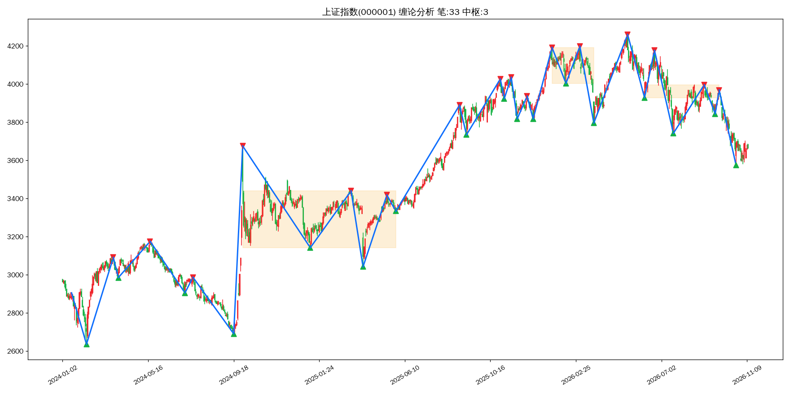

## 深证指数（399001）
- 最新收盘价：11335.6904296875
- 有效K线数量：686
- 笔总数：29 | 中枢总数：3
- 最新一笔走势：下跌 | 2026-09-22~2026-11-03 | 13914.21 → 10810.42
- 缠论背驰判断：**无背驰**
- 三类买卖点识别：**卖1类@2025-10-09(13725.56)、卖2类@2025-10-30(13532.13)、卖1p类@2026-06-22(16372.50)、卖2类@2026-08-18(14622.50)、卖2s类@2026-09-22(13723.74)、买1类@2026-11-03(10876.99)**
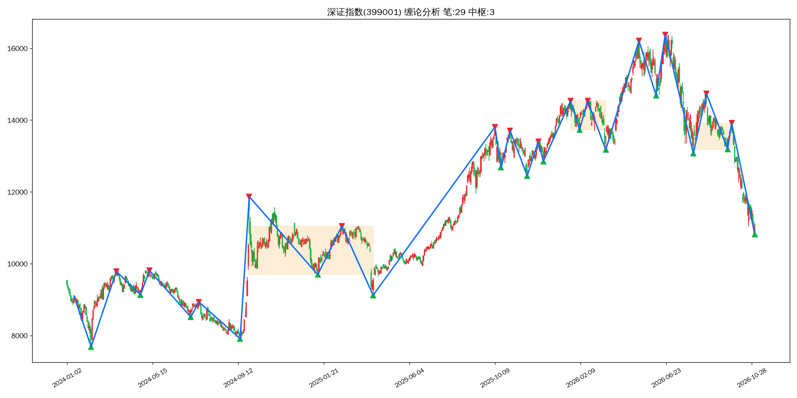

## 创业板指（399006）
- 最新收盘价：2566.8
- 有效K线数量：687
- 笔总数：31 | 中枢总数：3
- 最新一笔走势：下跌 | 2026-09-22~2026-11-04 | 3472.47 → 2376.28
- 缠论背驰判断：**无背驰**
- 三类买卖点识别：**买1类@2024-08-29(1541.40)、买2,3b类@2025-01-13(1982.46)、买2s类@2025-04-07(1807.21)、买2s类@2025-05-28(1985.38)、买2s类@2025-06-23(2017.63)、买3a类@2025-11-24(2929.04)、卖1p类@2026-01-13(3321.89)、卖2类@2026-02-25(3354.82)、买1类@2026-11-04(2544.73)**
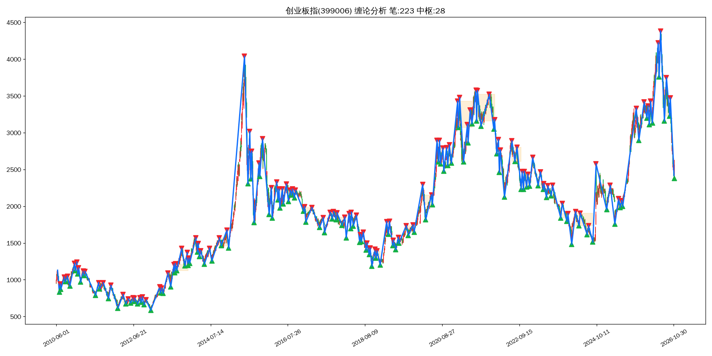

## 沪深300（000300）
- 最新收盘价：4113.41
- 有效K线数量：687
- 笔总数：42 | 中枢总数：4
- 最新一笔走势：上涨 | 2026-10-23~2026-11-05 | 3958.14 → 4136.80
- 缠论背驰判断：**上涨趋势背驰（警惕阶段顶部）**
- 三类买卖点识别：**卖1类@2026-01-13(4761.03)、卖2类@2026-02-25(4735.89)、卖2s类@2026-03-17(4637.44)、买1类@2026-10-23(4105.33)**
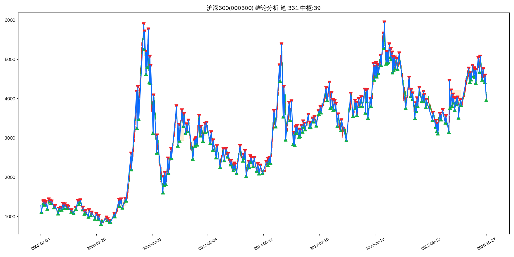

## 上证50（000016）
- 最新收盘价：2811.16
- 有效K线数量：687
- 笔总数：35 | 中枢总数：4
- 最新一笔走势：上涨 | 2026-10-23~2026-11-05 | 2676.64 → 2813.90
- 缠论背驰判断：**上涨趋势背驰（警惕阶段顶部）**
- 三类买卖点识别：**卖1类@2024-05-20(2532.82)、卖2类@2024-07-19(2456.79)、买1类@2026-10-23(2757.68)**
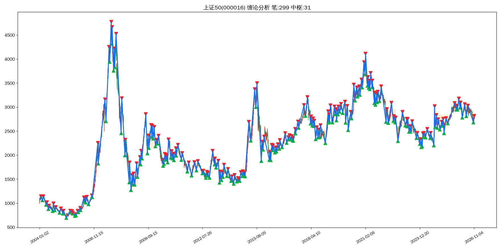
