# 批量缠论分析报告（chan.py 引擎 · 含买卖点+背驰判断）
> 数据区间：2024-01-01 ~ 2026-11-20

## 京东方A（000725）
- 最新收盘价：4.33
- 有效K线数量：697
- 笔总数：41 | 中枢总数：6
- 最新一笔走势：下跌 | 2026-09-23~2026-11-17 | 6.31 → 4.12
- 缠论背驰判断：**无背驰**
- 三类买卖点识别：**买1类@2024-09-18(3.55)、买2,3b类@2024-10-18(4.07)、买2s类@2024-11-27(4.21)、买2s类@2025-01-06(4.09)、买1类@2026-11-17(4.29)**
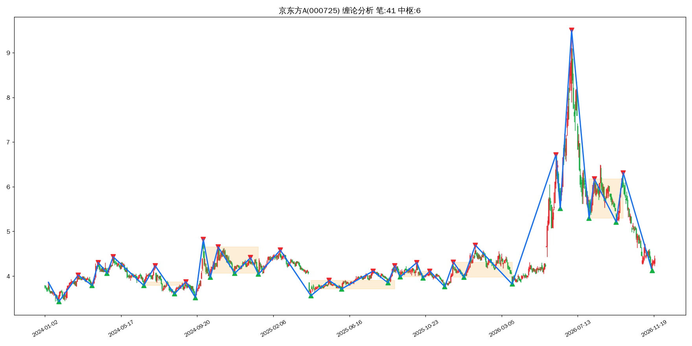

## 格力电器（000651）
- 最新收盘价：40.98
- 有效K线数量：697
- 笔总数：39 | 中枢总数：6
- 最新一笔走势：上涨 | 2026-10-27~2026-11-18 | 36.01 → 41.16
- 缠论背驰判断：**无背驰**
- 三类买卖点识别：**买1类@2024-07-05(30.99)、买2类@2024-08-13(33.07)、买2s,3b类@2024-09-12(33.66)、卖1类@2025-07-23(42.83)、卖2类@2025-08-12(42.59)、卖3b类@2025-11-12(38.21)、买1类@2026-03-04(35.12)、买2类@2026-04-22(35.16)**
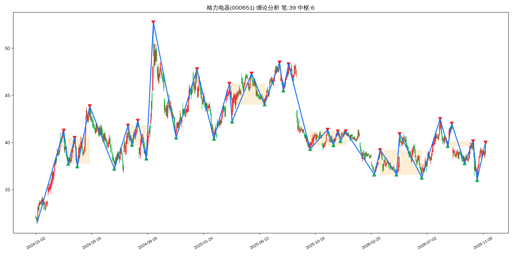

## 长安汽车（000625）
- 最新收盘价：6.89
- 有效K线数量：697
- 笔总数：37 | 中枢总数：4
- 最新一笔走势：下跌 | 2026-10-27~2026-11-02 | 7.24 → 6.68
- 缠论背驰判断：**无背驰**
- 三类买卖点识别：**买1类@2024-08-29(11.25)、买2类@2024-09-18(11.14)、买1类@2026-06-29(7.11)、买2类@2026-08-25(7.10)、买2s类@2026-10-15(6.94)、买2s类@2026-11-02(6.99)**
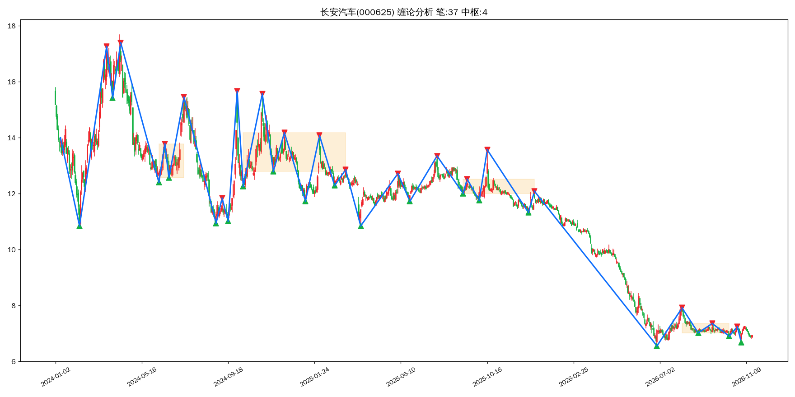

## 海南橡胶（601118）
- 最新收盘价：4.98
- 有效K线数量：697
- 笔总数：39 | 中枢总数：3
- 最新一笔走势：下跌 | 2026-11-11~2026-11-19 | 5.76 → 4.91
- 缠论背驰判断：**无背驰**
- 三类买卖点识别：**卖1p类@2026-03-12(8.34)、卖2类@2026-04-10(6.77)、卖2s类@2026-05-13(7.81)、卖2s类@2026-06-03(7.04)、卖3a类@2026-07-06(4.99)、买1p类@2026-07-20(4.68)、买2类@2026-08-14(5.28)**
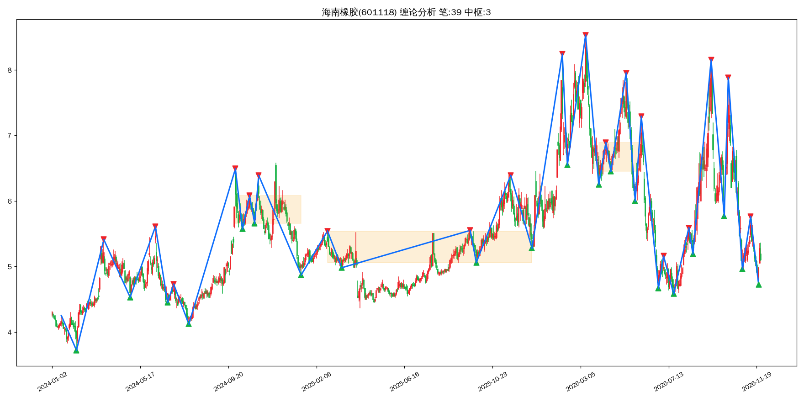

## 科大讯飞（002230）
- 最新收盘价：35.9
- 有效K线数量：697
- 笔总数：41 | 中枢总数：4
- 最新一笔走势：下跌 | 2026-11-05~2026-11-19 | 39.50 → 35.40
- 缠论背驰判断：**无背驰**
- 三类买卖点识别：**买1类@2024-08-28(33.17)、买2类@2024-10-16(42.81)、买2s类@2025-01-08(44.89)、卖1类@2025-02-24(57.20)、卖2类@2025-05-08(48.05)、卖2s类@2025-06-09(48.60)、卖2s类@2025-07-01(47.62)**
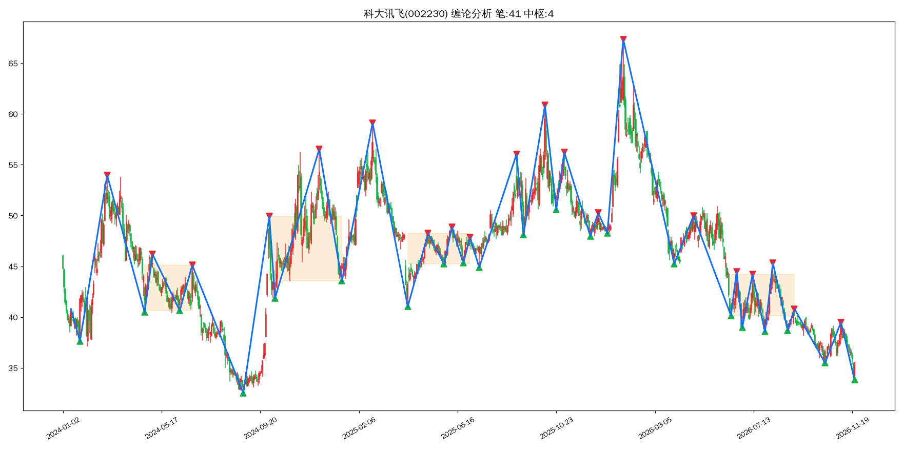

## 中国宝安（000009）
- 最新收盘价：6.33
- 有效K线数量：697
- 笔总数：31 | 中枢总数：3
- 最新一笔走势：下跌 | 2026-11-05~2026-11-16 | 6.85 → 6.25
- 缠论背驰判断：**无背驰**
- 三类买卖点识别：**买1类@2025-04-09(7.55)、买2类@2025-06-03(7.87)**
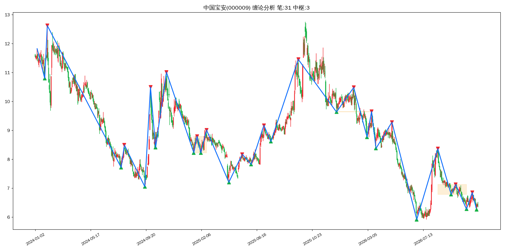

## 海格通信（002465）
- 最新收盘价：8.81
- 有效K线数量：697
- 笔总数：37 | 中枢总数：3
- 最新一笔走势：下跌 | 2026-11-10~2026-11-19 | 10.55 → 8.78
- 缠论背驰判断：**无背驰**
- 三类买卖点识别：**卖1类@2025-08-29(14.56)、卖2类@2025-09-12(13.85)、买1类@2026-11-19(8.81)**
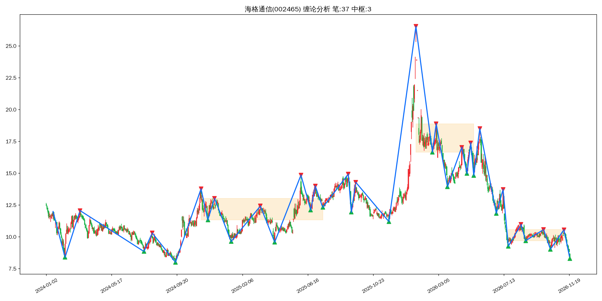

## 郑州银行（002936）
- 最新收盘价：1.76
- 有效K线数量：697
- 笔总数：27 | 中枢总数：3
- 最新一笔走势：上涨 | 2026-10-23~2026-11-04 | 1.67 → 1.83
- 缠论背驰判断：**无背驰**
- 三类买卖点识别：**卖1类@2024-12-10(2.24)、卖2类@2025-02-18(1.99)、卖2s类@2025-07-11(2.22)、卖2s类@2025-09-18(2.07)、卖2s类@2025-11-14(2.07)、卖2s,3b类@2026-01-13(1.96)、卖2s类@2026-03-17(1.95)、买1类@2026-07-01(1.68)、买2类@2026-08-24(1.77)、买2s类@2026-10-23(1.70)**
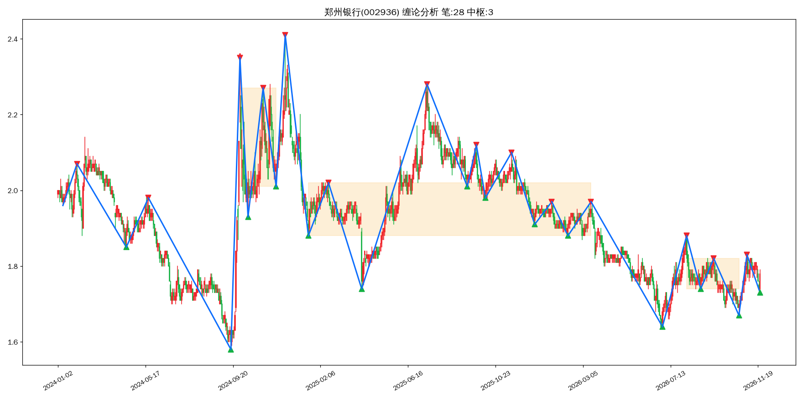

## 中国平安（601318）
- 最新收盘价：54.66
- 有效K线数量：697
- 笔总数：43 | 中枢总数：3
- 最新一笔走势：上涨 | 2026-10-23~2026-11-17 | 50.11 → 54.88
- 缠论背驰判断：**上涨趋势背驰（警惕阶段顶部）**
- 三类买卖点识别：**买1类@2025-01-13(44.17)、买2类@2025-03-04(45.52)、买3a类@2025-06-19(48.36)、卖1p类@2025-07-30(56.78)、卖2类@2025-08-29(56.01)**
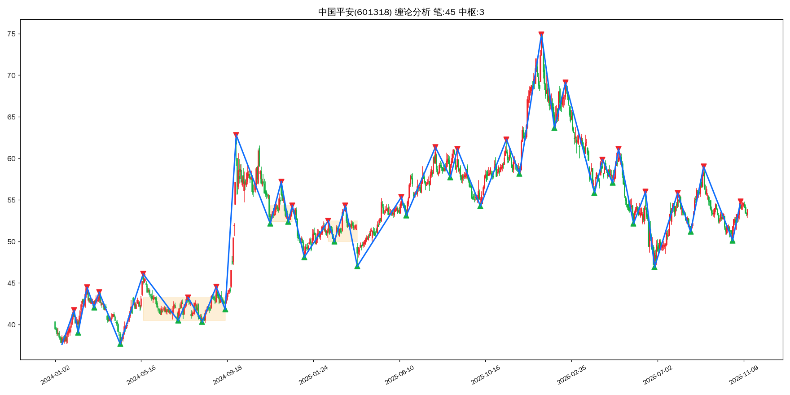

## 美的集团（000333）
- 最新收盘价：95.01
- 有效K线数量：697
- 笔总数：33 | 中枢总数：5
- 最新一笔走势：上涨 | 2026-10-08~2026-11-19 | 78.30 → 95.66
- 缠论背驰判断：**无背驰**
- 三类买卖点识别：**买1类@2025-04-07(60.67)、买2类@2025-06-09(68.09)、买2s类@2025-07-31(66.45)、买2s类@2025-10-13(67.98)、卖1类@2025-12-04(78.01)、卖2类@2026-02-05(76.64)**
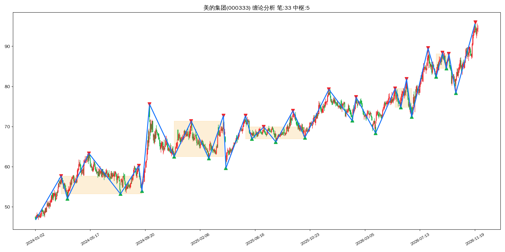

## 比亚迪（002594）
- 最新收盘价：80.38
- 有效K线数量：697
- 笔总数：53 | 中枢总数：8
- 最新一笔走势：下跌 | 2026-11-05~2026-11-19 | 86.98 → 78.09
- 缠论背驰判断：**无背驰**
- 三类买卖点识别：**卖1类@2025-05-23(132.91)、卖2类@2025-07-24(112.47)、卖2s类@2025-08-29(113.64)、卖3a类@2025-11-14(98.00)、买1p类@2025-11-21(92.36)、买2类@2025-12-18(93.18)**
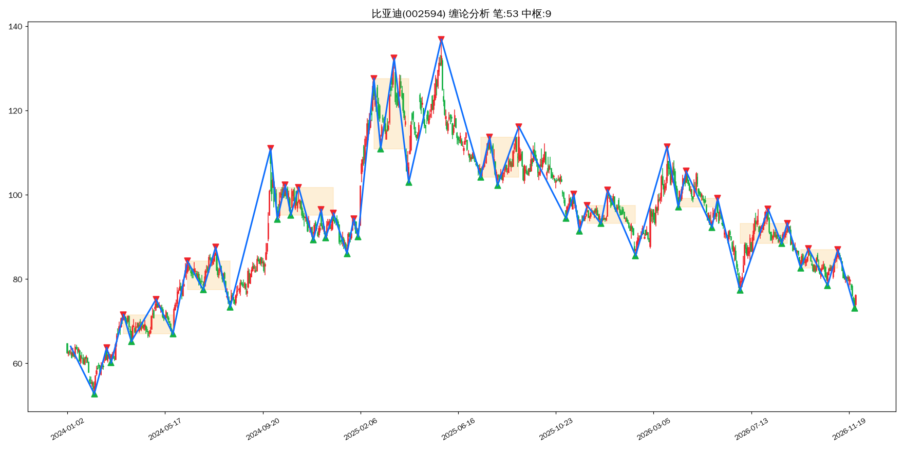

## 上证指数（000001）
- 最新收盘价：3577.617
- 有效K线数量：697
- 笔总数：33 | 中枢总数：3
- 最新一笔走势：下跌 | 2026-09-22~2026-11-19 | 3967.68 → 3547.94
- 缠论背驰判断：**无背驰**
- 三类买卖点识别：**卖1p类@2025-11-14(3990.49)、卖2类@2025-12-08(3924.08)、买1类@2026-11-19(3577.62)**
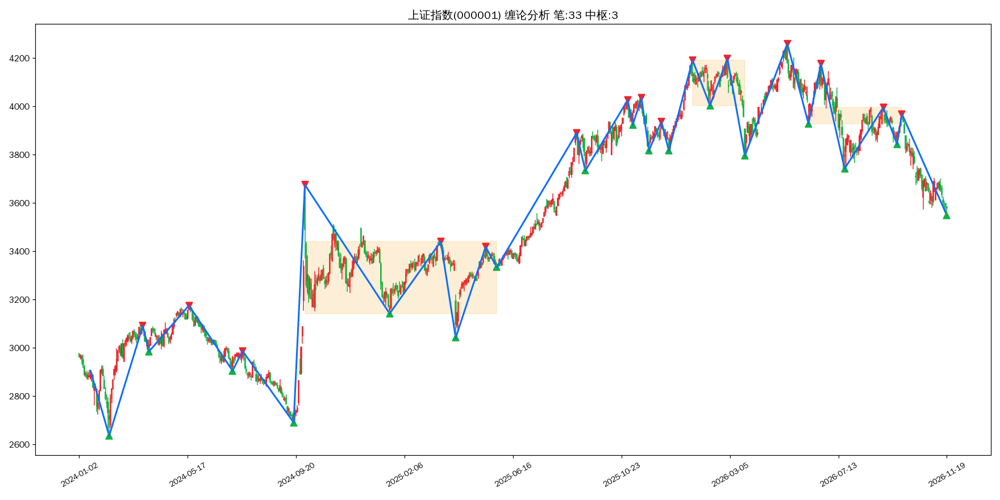

## 深证指数（399001）
- 最新收盘价：10583.204
- 有效K线数量：697
- 笔总数：29 | 中枢总数：3
- 最新一笔走势：下跌 | 2026-09-22~2026-11-19 | 13914.21 → 10505.84
- 缠论背驰判断：**无背驰**
- 三类买卖点识别：**卖1类@2025-10-09(13725.56)、卖2类@2025-10-30(13532.13)、卖1p类@2026-06-22(16372.50)、卖2类@2026-08-18(14622.50)、卖2s类@2026-09-22(13723.74)、买1类@2026-11-19(10583.20)**
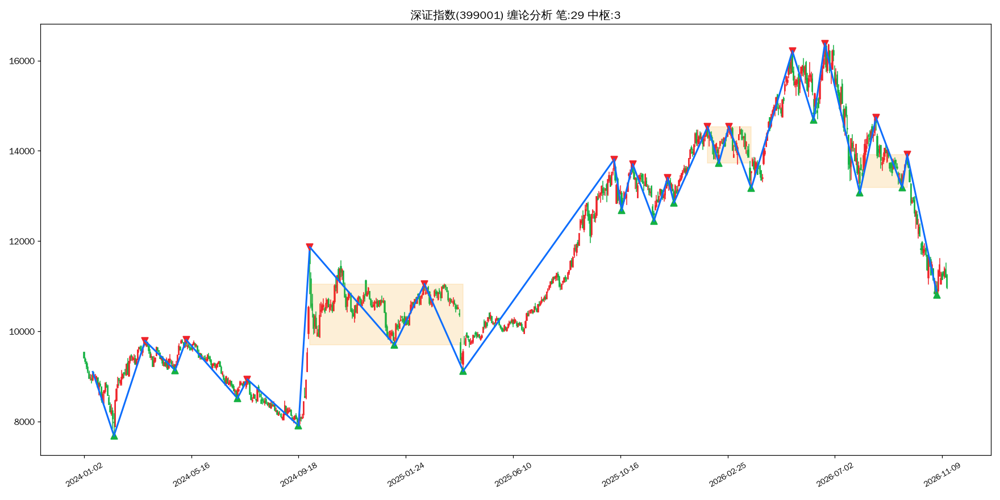

## 创业板指（399006）
- 最新收盘价：2293.342
- 有效K线数量：697
- 笔总数：31 | 中枢总数：3
- 最新一笔走势：下跌 | 2026-09-22~2026-11-17 | 3472.47 → 2263.74
- 缠论背驰判断：**无背驰**
- 三类买卖点识别：**买1类@2024-08-29(1541.40)、买2,3b类@2025-01-13(1982.46)、买2s类@2025-04-07(1807.21)、买2s类@2025-05-28(1985.38)、买2s类@2025-06-23(2017.63)、买3a类@2025-11-24(2929.04)、卖1p类@2026-01-13(3321.89)、卖2类@2026-02-25(3354.82)、买1类@2026-11-17(2292.20)**
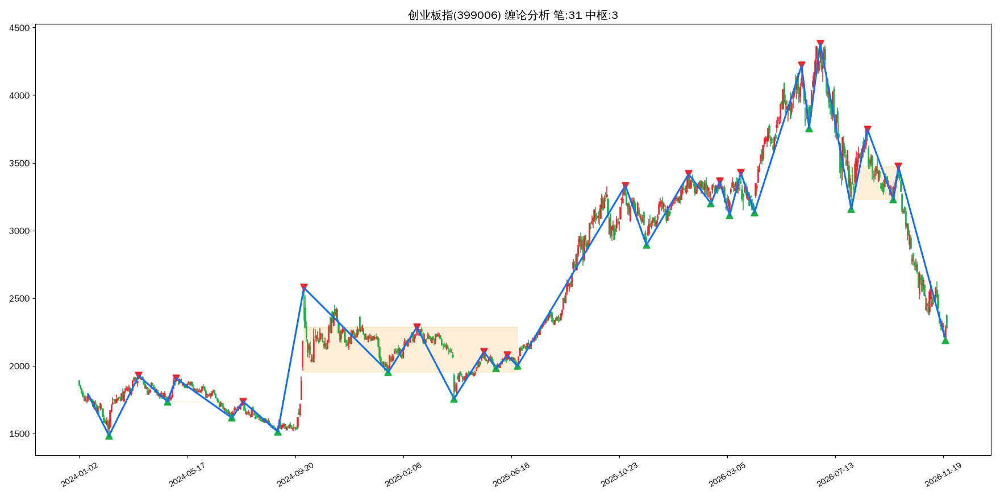

## 沪深300（000300）
- 最新收盘价：3984.84
- 有效K线数量：697
- 笔总数：43 | 中枢总数：4
- 最新一笔走势：下跌 | 2026-11-05~2026-11-17 | 4136.80 → 3942.38
- 缠论背驰判断：**无背驰**
- 三类买卖点识别：**卖1类@2026-01-13(4761.03)、卖2类@2026-02-25(4735.89)、卖2s类@2026-03-17(4637.44)、买1p类@2026-11-17(3976.46)**
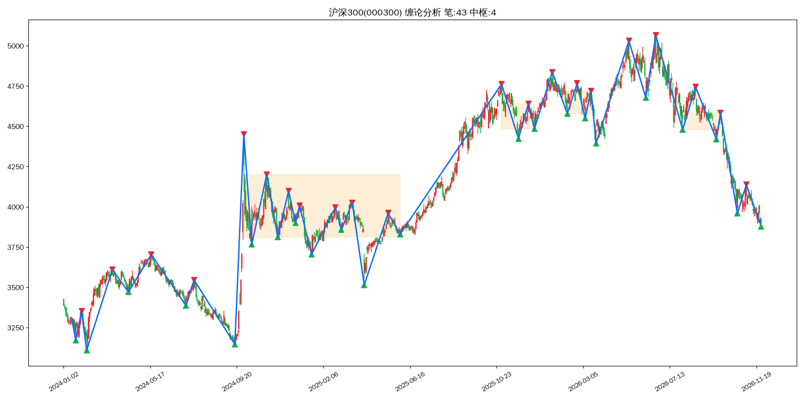

## 上证50（000016）
- 最新收盘价：2773.459
- 有效K线数量：697
- 笔总数：36 | 中枢总数：4
- 最新一笔走势：下跌 | 2026-11-05~2026-11-17 | 2813.90 → 2739.54
- 缠论背驰判断：**下跌趋势背驰（关注阶段底部）**
- 三类买卖点识别：**卖1类@2024-05-20(2532.82)、卖2类@2024-07-19(2456.79)、买1类@2026-10-23(2757.68)、买2类@2026-11-17(2768.36)**
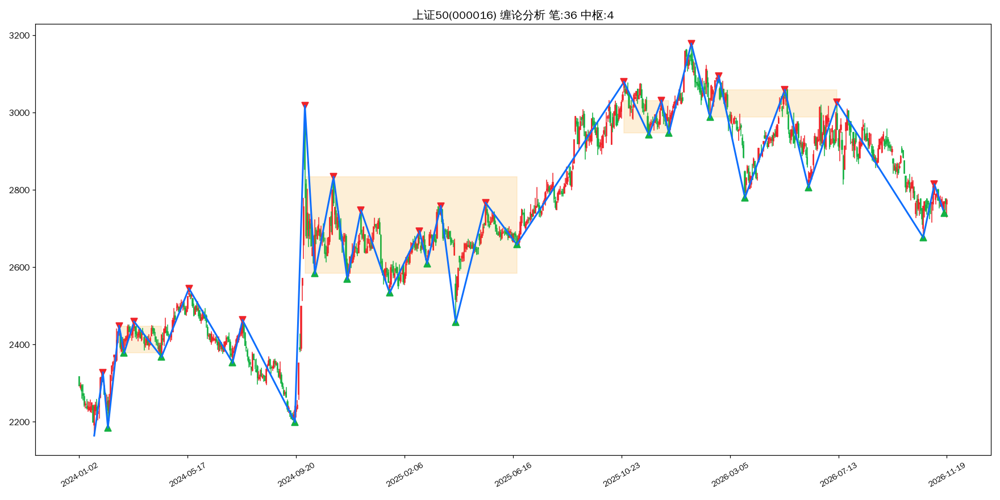
